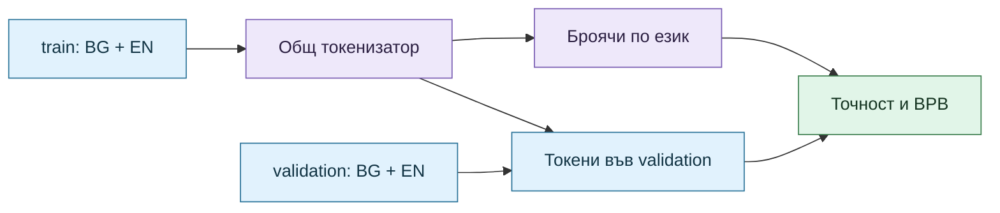

# Tokenization & N-grams

**TUES AI · Домашно**

Направи три токенизатора за един и същ корпус от българска и английска Wikipedia. Сравни колко място заемат токените и колко добре модел предсказва следващия токен. После обучи свой n-грамов модел и го сравни с референтния.

[Предаване и класации](https://tuesai.org/homework/tokenization-ngrams) · [Формат на JSON](docs/FORMAT.md) · [Тетрадки от часа](class/README.md) · [Упражнение: генериране](docs/SAMPLING.md)

## 1. Пусни базовия вариант

Клонирай [хранилището](https://github.com/TUES-AI/Tokenization-NGrams) или избери **Code → Download ZIP** и разархивирай. Отвори терминал в папката с този README. Трябват ти Python 3.12+ и обикновен лаптоп. Няма пакети за инсталиране, GPU или допълнителни файлове за сваляне. Ако стартираш Python с `python3` или `py`, използвай тази команда вместо `python`.

```sh
python -m starter.build byte --out output/byte.json
python -m starter.evaluate --examples output/byte.json
```

Първата команда създава готов за качване byte JSON. Втората го сравнява с два малки **необучени** примера за word и BPE върху 8 откъса от всеки език за всеки дял. Таблицата показва `overall`, `bg` и `en`; `-` означава, че няма стойност. Примерите са само за разчитане на таблицата.

### Зареди корпуса

В `data/` има четири gzip файла (`train` и `validation` по `bg` и `en`), по един откъс на ред. Loader-ът ги чете като UTF-8 направо от архива. В Python, стартиран от главната папка:

```python
from itertools import islice
from data.loader import iter_texts, load_split

# Първите 8 откъса от всеки език, без да четем целия train.
train = {lang: list(islice(iter_texts("train", lang), 8)) for lang in ("bg", "en")}
print(train["bg"][0], train["en"][0], sep="\n\n")

validation = load_split("validation")  # речник с отделни списъци за bg и en
```

Корпусът заема около 2.2 MB на диска. Виж [описанието и лиценза](data/README.md). Обучавай само върху `train`. Ползвай `validation` за сравнение и избор на настройки. Сайтът оценява върху отделен набор.

## 2. Сравни и предай три токенизатора

| Вариант | Твоята задача |
|---|---|
| **Byte** | Използвай базовия вариант: един ID за всеки UTF-8 байт. Провери на ръка с `AБ`. |
| **Word** | Довърши `train_word` в [`starter/build.py`](starter/build.py). Започни с всички различни думи от избраните `train` откъси на двата езика, разделени по празни знаци. Една и съща дума има един ID в общия речник. Ако намалиш `--size`, остави най-честите думи и сравни какво губиш. Непознатите думи се кодират с оригиналните байтове. За допълнителни разделители виж `boundaries` във [формата](docs/FORMAT.md#words-with-byte-fallback). |
| **BPE** | Довърши `train_bpe`. Започни с 256 ID за байтовете (0–255) и учи по едно сливане на съседна двойка. Записвай сливанията в научения ред; максимум 65 280 сливания (65 536 ID общо, по 16 бита на токен). |

```sh
python -m starter.build word --rows 32 --size 4096 --out output/word.json
python -m starter.build bpe --rows 32 --size 128 --out output/bpe.json
python -m starter.evaluate --rows 32 output/byte.json output/word.json output/bpe.json
```

`--rows` на `build` задава броя обучаващи откъси **на език**, а `--size` ограничава думите или сливанията. Първо пробвай с малки стойности. Сравнявай вариантите върху еднакви редове: `--rows` на `evaluate` увеличава локалната проверка до [лимитите на оценителя](docs/FORMAT.md#limits-and-local-api).

По-малък `token_count` не гарантира по-малък `total_bits`: по-широките ID и самият речник заемат място. По-висока точност също не означава по-нисък **BPB** (битове на оригинален байт); точността брои правилните избори, а BPB отчита вероятността, дадена на всеки верен токен. Сравнявай BPB между варианти без загуба на текст.

Влез в сайта с училищния си акаунт и качи `byte.json`, `word.json` и `bpe.json` поотделно. Качвай само JSON, без код, notebook или ZIP. **Класациите във всички категории са публични. До резултата се вижда показваното име от училищния ти акаунт.** Варианти със загуба на информация получават обратна връзка, но не участват в класациите.

## 3. Обучи и предай n-грами



Довърши `train_ngrams` и го пусни за **всеки от трите токенизатора**. Подадената функция `encode(document)` връща точно ID-тата, които ползва оценителят. Брой съседните последователности от 1 до 3, отделно за BG и EN, без да пресичаш граница между откъси. Виж [формата и лимитите за броячите](docs/FORMAT.md#optional-submitted-n-gram-counts).

```sh
python -m starter.build byte --rows 32 --order 3 --tokenizer-from output/byte.json --out output/byte-ngram.json
python -m starter.build word --rows 32 --order 3 --tokenizer-from output/word.json --out output/word-ngram.json
python -m starter.build bpe --rows 32 --order 3 --tokenizer-from output/bpe.json --out output/bpe-ngram.json
python -m starter.evaluate --rows 32 output/byte-ngram.json output/word-ngram.json output/bpe-ngram.json
```

`--tokenizer-from` запазва същите ID от първия JSON. Качи трите нови `*-ngram.json` файла поотделно. Локално референтният модел също брои до ред 3 върху същите 32 обучаващи откъса на език. Ако броячите ти са верни, `submitted_accuracy` и `submitted_bpb` трябва да съвпадат с `reference_accuracy` и `reference_bpb` за всеки от трите токенизатора. При разлика първо провери дали броиш и по-късите n-грами и дали спираш на границата на всеки откъс.

Попълни от редовете `overall` на локалната проверка. Сравни и редовете `bg` и `en` за една разлика между двата езика.

| Модел | Токени / общо битове | Реф. точност / BPB | Твои точност / BPB |
|---|---|---|---|
| Byte | … / … | … / … | … / … |
| Word | … / … | … / … | … / … |
| BPE | … / … | … / … | … / … |

**Втори опит:** За един от токенизаторите промени само реда от 3 на 2. Например за byte:

```sh
python -m starter.build byte --rows 32 --order 2 --tokenizer-from output/byte.json --out output/byte-bigram.json
python -m starter.evaluate --rows 32 output/byte-ngram.json output/byte-bigram.json
```

Запиши как се променят точността и BPB, когато моделът вижда най-много един предишен токен вместо два. Ако някоя метрика остане същата, предложи обяснение. Този опит остава в локалния отчет.

## 4. Генерирай и обясни резултатите

Направи [упражнението с greedy и претеглено теглене](docs/SAMPLING.md). Запази кратък отчет за себе си с няколко извадки, метриките и какво според теб обяснява разликите.

### Видеа от Andrej Karpathy

- [Let’s build the GPT Tokenizer](https://www.youtube.com/watch?v=zduSFxRajkE) · байтове, сливане на двойки и BPE
- [The spelled-out intro to language modeling: building makemore](https://www.youtube.com/watch?v=PaCmpygFfXo) · броене, вероятности и генериране с биграмен модел

[Условия за ползване на учебните материали](USE.md)
