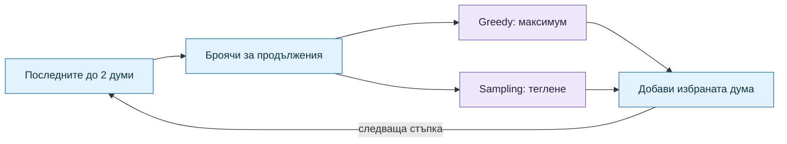

# Упражнение: greedy срещу sampling

Два генератора получават еднакъв начален текст и еднакви броячи. **Greedy** винаги избира най-честото продължение (при равенство: първата дума по азбучен ред). **Претегленото теглене** избира на случаен принцип, с шанс пропорционален на броя. И при двата избраната дума става част от следващия контекст.



## 1. Предвиди и провери

Отвори таблицата `NEXT` в [`starter/sample.py`](../starter/sample.py). Предвиди първата дума на greedy за `the robot` и `the pilot`. Какъв е шансът при теглене да се падне `writes` за всеки от двата контекста?

Пусни от главната папка:

```sh
python -m starter.sample --prompt "the robot" --steps 8 --seeds 1 2 7
python -m starter.sample --prompt "the pilot" --steps 8 --seeds 1 2 7
python -m starter.sample --prompt "a stranger" --steps 8 --seeds 1 2 7
```

Всяка команда показва едно greedy продължение и три претеглени продължения. `seed` е началната стойност за генератора на случайни числа. Повтори една команда без промени. Намери първата стъпка, на която два изхода се различават, и обясни как това променя следващия контекст. Какво става, когато началният текст липсва в таблицата?

Това е малък модел с готови броячи за думи. При липсващ контекст скъсява историята, а после тегли само от намерените продължения. [Оценителят](FORMAT.md#how-the-grader-evaluates-prediction) използва изгладени вероятности и предсказва от **истинските** предишни токени. Генераторът тук предсказва от собствения си изход.

## 2. Запиши до една страница

- За два начални текста запиши greedy и трите претеглени продължения едно до друго с техните seeds. Обясни едно равенство или разклонение и един случай на липсващ контекст.
- Запиши `token_count`, `total_bits`, референтната точност и BPB за трите токенизатора върху една и съща локална проверка. Посочи по една интересна разлика между BG и EN и между `token_count` и `total_bits`.
- За всеки от трите n-грамови модела запиши токенизатора, реда, точността и BPB. Какво се промени спрямо референтния модел със същия токенизатор?

Запази отчета локално. На сайта се качват само артефактите във формат JSON.
